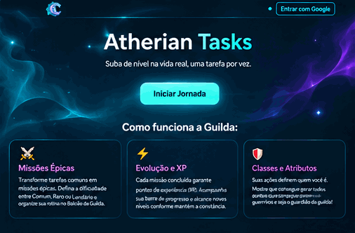

# 🎮 Atherian Tasks - Gerenciador de Tarefas Gamificado

=> <a href="https://ichristinacarvalho.github.io/atherian-tasks/">Acesse o site</a>

Bem-vindo ao repositório oficial do **Atherian Tasks**, uma aplicação web interativa desenvolvida para transformar a gestão de tarefas e hábitos diários em uma experiência engajadora através de conceitos de **gamificação e sistema de XP**.

---

## 🚀 Funcionalidades & Arquitetura

- **Interface Responsiva & Moderna**: Design fluido e intuitivo, totalmente adaptado para proporcionar uma excelente experiência em computadores, tablets e smartphones.
- **Sistema de XP e Gamificação**: Ganhe pontos de experiência (XP) e evolua de nível à medida que conclui suas tarefas e hábitos diários, transformando a produtividade em um jogo.
- **Autenticação & Banco de Dados em Tempo Real**: Integração completa com o **Firebase (Auth e Firestore)** para gerenciar o cadastro de usuários e sincronizar as tarefas de forma segura.
- **Gerenciamento Completo de Tarefas**: Adicione, edite, organize e conclua pendências com feedback visual imediato e recompensas por progresso.

---

## 🛠️ Tecnologias Utilizadas

Este projeto foi construído utilizando as seguintes tecnologias e ferramentas:

- **HTML5 / CSS3 / JavaScript (ES6+)**: Estruturação semântica, estilização avançada e manipulação dinâmica do DOM.
- **Firebase (Auth & Firestore)**: Autenticação de usuários e banco de dados NoSQL em nuvem para persistência em tempo real.
- **Git & GitHub**: Controle de versão e hospedagem contínua via GitHub Pages.
